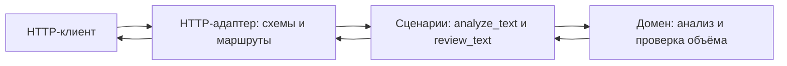

# python-serverless-lab

Учебный сервис анализа текста с профессиональными контрактами, тестами и
воспроизводимыми зависимостями. Маршрут проекта: Python → Docker Compose →
локальный Kubernetes через kind → Knative Serving.

Сейчас реализован **этап 1: Python и HTTP** с двумя текстовыми операциями. Docker Compose на следующем этапе
будет описывать запуск контейнера, а `docker/Dockerfile` — сборку образа.
Планируемый корневой `compose.yaml` будет использовать контекст `./app` и
Dockerfile `../docker/Dockerfile`. Эти файлы пока не созданы. В дальнейшем тот же
образ будет работать в Knative; отдельный Nginx для текущей задачи не нужен.

FastAPI предоставляет HTTP-интерфейс. Serverless-масштабирование появится на этапе
Knative: сам Python-сервер или запуск через Compose его не демонстрирует.

## Архитектура



`main.create_app()` собирает приложение. `http/` отвечает за внешний контракт,
`application/` — за операции приложения и порядок выполнения сценария, а `domain/`
— за вычисления и бизнес-правила. Оба внутренних слоя используют только стандартную
библиотеку Python и вызываются без HTTP-сервера.

Операция `review_text` анализирует текст, проверяет допустимое число слов и собирает
отчёт. Оба сценария используют один доменный алгоритм анализа. Прикладной вход
`analyze_text` короткий: он предоставляет существующий анализ через ту же границу
приложения. В HTTP маршруты принимают данные и вызывают сценарий, а функции
`http/presenters.py` преобразуют его результат в модели ответа. Общий
`to_analyze_response` используется и для анализа, и внутри `to_review_text_response`.

```text
app/
├── pyproject.toml                 # зависимости и настройки проверок
├── uv.lock                        # точные версии, включая транзитивные
├── .python-version                # Python 3.14.9
├── .venv/                         # локальное окружение, исключено из Git
├── src/serverless_lab/
│   ├── main.py                    # фабрика приложения
│   ├── domain/
│   │   ├── analysis.py            # общий алгоритм анализа и его типы
│   │   └── word_count.py          # политика диапазона и правило проверки
│   ├── application/
│   │   └── text_operations.py     # оба сценария и составной отчёт
│   └── http/
│       ├── schemas.py             # модели JSON
│       ├── routes.py              # /analyze, /review-text, /health
│       ├── presenters.py          # преобразование результатов в HTTP-модели
│       └── errors.py              # безопасный ответ 422
└── tests/
    ├── domain/                   # анализ и правила объёма
    ├── application/              # составной сценарий
    └── http/                     # запросы, ошибки, health и OpenAPI
```

Файлы `__init__.py` в дереве опущены. Будущая инфраструктура размещается в
`infra/kind/` и `infra/k8s/`, сценарии управления — в `scripts/`.

## Установка и запуск

Проверенное окружение: Linux x86_64, CPython 3.14.9, uv 0.13.5. Для первоначальной
установки нужен интернет. Docker и Kubernetes для этого этапа не требуются.
Проект поддерживает Python 3.14; конкретный интерпретатор закреплён в
`app/.python-version`. Системный Python менять не требуется.

Если uv ещё не установлен, установите закреплённую версию официальным установщиком:

```bash
curl --fail --location https://astral.sh/uv/0.13.5/install.sh -o /tmp/uv-install.sh
sh /tmp/uv-install.sh
export PATH="$HOME/.local/bin:$PATH"
uv --version
```

Из корня проекта:

```bash
cd app
uv sync --locked
uv run --locked uvicorn serverless_lab.main:create_app --factory --host 127.0.0.1 --port 8000
```

`uv` создаёт `app/.venv/` и при необходимости загружает закреплённый Python.
`--locked` запрещает незаметное обновление зависимостей. `--factory` указывает,
что сервер должен вызвать `create_app()`. Остановить сервер можно через `Ctrl+C`.
Если порт 8000 занят, выберите свободный через `--port` и измените URL запросов.

Из другого терминала:

```bash
curl --fail-with-body http://127.0.0.1:8000/health
curl --fail-with-body http://127.0.0.1:8000/analyze \
  -H 'Content-Type: application/json' \
  -d '{"text":"Привет, мир! Привет.","top_k":5}'
```

Первый запрос возвращает `{"status":"ok"}`. Второй — HTTP 200:

```json
{
  "characters": 20,
  "words": 3,
  "top_words": [
    {"word": "привет", "count": 2},
    {"word": "мир", "count": 1}
  ]
}
```

Интерактивное описание API: `http://127.0.0.1:8000/docs`.
JSON-схема OpenAPI: `http://127.0.0.1:8000/openapi.json`.

## Контракт

- `text`: обязательная строка длиной 1–10 000 кодовых точек Unicode; пустые и
  состоящие только из пробельных символов строки отклоняются. Типы не преобразуются.
- `characters`: длина **исходной** строки, включая пробелы и пунктуацию. Кодовая
  точка — единица Unicode; один видимый символ может состоять из нескольких точек.
- Слова: сначала нормализация NFC, объединяющая канонически эквивалентные записи,
  затем `casefold()` для сравнения без учёта регистра. Слово — последовательность
  символов с `isalpha() == True`; цифры, дефисы и подчёркивания разделяют слова.
- `words`: полное количество слов до ограничения списка. Допустимый текст без
  букв возвращает ноль слов и пустой список.
- `top_words`: сортировка по убыванию частоты, затем по слову в порядке Python.
- `top_k`: целое число 1–10, по умолчанию 5. Строки, дробные числа, `null` и
  логические значения отклоняются. Неизвестные поля также запрещены.

Некорректный JSON или входные данные дают HTTP 422:

```json
{"detail":"Invalid request."}
```

Ответ намеренно не раскрывает исходный текст и внутренние ошибки библиотек.
Неожиданные ошибки программы не превращаются в ошибку пользовательского ввода.
`/health` подтверждает отзывчивость процесса, а не готовность будущего кластера.

Прямой вызов из `app/`:

```bash
uv run --locked python -c 'from serverless_lab.domain.analysis import analyze_text; print(analyze_text("Привет, мир! Привет."))'
```

Функция принимает типизированные аргументы `str` и `int`. Некорректные значения
этих аргументов вызывают `AnalysisInputError`. Данные неизвестного типа должны
пройти проверку на внешней границе; аннотации Python сами не выполняют валидацию.

## Второй пример: проверка объёма текста

`POST /review-text` использует те же `text` и необязательный `top_k`. Дополнительно
передайте `min_words` и `max_words`: обязательные целые числа от 1 до 10 000,
без преобразования типов. Нижняя граница не должна превышать верхнюю.

```bash
curl --fail-with-body http://127.0.0.1:8000/review-text \
  -H 'Content-Type: application/json' \
  -d '{"text":"Привет, мир! Привет.","min_words":4,"max_words":8}'
```

Ответ HTTP 200:

```json
{
  "analysis": {
    "characters": 20,
    "words": 3,
    "top_words": [{"word": "привет", "count": 2}, {"word": "мир", "count": 1}]
  },
  "word_count_check": {"min_words": 4, "max_words": 8, "status": "too_short"}
}
```

Статус `within_range` означает попадание в диапазон, включая границы;
`too_long` — превышение верхней границы. `top_k` ограничивает только список
частот: решение всегда использует полное число слов. Текст без букв получает
`too_short`. Проверка оценивает объём, а не качество содержания.

Несоответствие объёму возвращается с HTTP 200. Некорректные параметры, например
`min_words > max_words`, дают HTTP 422 с тем же безопасным сообщением.

Прямой вызов прикладного сценария из `app/`:

```bash
uv run --locked python - <<'PY'
from serverless_lab.application.text_operations import review_text
from serverless_lab.domain.word_count import WordCountPolicy

result = review_text("Привет, мир! Привет.", WordCountPolicy(4, 8))
print(result.analysis.words, result.status.value)
PY
```

Результат: `3 too_short`. `WordCountPolicy` — неизменяемые требования к объёму;
они проверяются при создании и при некорректных значениях вызывают
`WordCountInputError` даже без HTTP.

## Проверки

Выполняйте из `app/`:

```bash
uv sync --locked
uv run --locked pytest
uv run --locked ruff check .
uv run --locked ruff format --check .
uv run --locked mypy src tests
uv build --no-build-isolation --wheel
```

Последняя команда использует установленный через lock-файл `uv_build` из группы
разработки и создаёт wheel — устанавливаемый пакет — в `app/dist/`.

| Принцип | Файл или настройка | Проверка | Результат этапа |
| --- | --- | --- | --- |
| Независимая бизнес-логика | `domain/`, `application/` | `uv run --locked pytest tests/domain tests/application` | анализ, политика и составной сценарий; прямой вызов без FastAPI/Pydantic |
| Строгий HTTP-контракт | `http/`, `main.py` | `uv run --locked pytest tests/http` | обе операции, 200/422, Unicode, границы, OpenAPI |
| Воспроизводимость | `uv.lock`, `.python-version` | `uv sync --locked` | Python 3.14.9, установка закреплённых зависимостей |
| Статические контракты | строгий mypy и плагин Pydantic | `uv run --locked mypy src tests` | исходники и тесты без ошибок типов |
| Единый стиль | Ruff | команды lint/format выше | проверки проходят |
| Корректная упаковка | `uv_build`, `src/` | установка wheel вне рабочей папки | импорт функции и создание приложения проверены |

Тесты HTTP используют реальное приложение через TestClient. Дополнительно
на исходном этапе 1 проверены настоящий запуск Uvicorn и HTTP-запросы к
установленному wheel. После расширения прошли **116 тестов**, Ruff и строгий mypy.
Прямой Python-пример и HTTP-примеры проверки объёма выполнены на обновлённом
приложении через настоящий Uvicorn; временный сервер остановлен. Обновлённый
wheel также установлен и проверен вне проекта: новые модули, прямой сценарий,
фабрика приложения и HTTP-запросы работают. Независимое ревью завершено без
существенных замечаний.
Проверки выполнялись 2026-10-25. В ограниченной агентской песочнице обнаружено
зависание межпоточного вызова AnyIO; HTTP-проверки выполнены вне этого ограничения.

## Учебный шаг и дальнейшая работа

Упражнение: отправьте `Кот кот, ПЁС пёс!` в `/review-text` с `min_words=4`,
`max_words=4`, `top_k=1`. Затем уменьшите только `max_words` и `min_words` до 3
и объясните изменение статуса при неизменной статистике.

Вопросы для самопроверки:

1. Какие решения принадлежат `domain`, а какие — `application`? Почему HTTP не сравнивает число слов с границами?
2. Почему `too_short` возвращается с HTTP 200, а перевёрнутый диапазон — с HTTP 422?

Следующий этап — сборка и проверка того же приложения в Docker Compose.
Масштабирование, инфраструктура и CI ещё не реализованы. Локальная папка `docs/`
с расширенными учебными материалами исключена из Git по настройке проекта;
этот README содержит все команды, необходимые для первого этапа.
