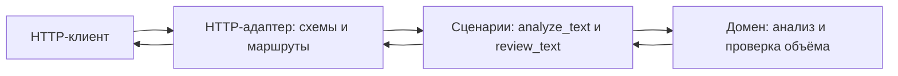

# python-serverless-lab

Учебный сервис анализа текста с профессиональными контрактами, тестами и
воспроизводимыми зависимостями. Маршрут проекта: Python → Docker Compose →
локальный Kubernetes через kind → Knative Serving.

Реализованы Python/HTTP и контейнерный запуск через Docker Compose. Корневой
`compose.yaml` описывает запуск, а `docker/Dockerfile` — многоэтапную сборку образа.
Контекст сборки — `./app`, путь к Dockerfile — `../docker/Dockerfile`.
Тот же образ работает в Knative; отдельный Nginx не требуется.

FastAPI предоставляет HTTP-интерфейс, а Knative управляет экземплярами приложения
по входящим запросам. Compose запускает один постоянный контейнер.

## Архитектура



`app_factory.create_app()` собирает приложение. `http/` отвечает за внешний контракт,
`application/` — за операции приложения и порядок выполнения сценария, а `domain/`
— за вычисления и бизнес-правила. Оба внутренних слоя используют только стандартную
библиотеку Python и вызываются без HTTP-сервера.

Операция `review_text` анализирует текст, проверяет допустимое число слов и собирает
отчёт. Оба сценария используют один доменный алгоритм анализа. Прикладной вход
`analyze_text` короткий: он предоставляет существующий анализ через ту же границу
приложения. В HTTP маршруты принимают данные и вызывают сценарий, а функции
`http/presenters.py` преобразуют его результат в модели ответа. Общий
`to_analyze_response` используется и для анализа, и внутри `to_review_text_response`.

```text
app/
├── pyproject.toml                 # зависимости и настройки проверок
├── uv.lock                        # точные версии, включая транзитивные
├── .python-version                # Python 3.14.9
├── .venv/                         # локальное окружение, исключено из Git
├── src/serverless_lab/
│   ├── __main__.py                # запуск Uvicorn и настройка логирования
│   ├── app_factory.py             # фабрика ASGI-приложения
│   ├── logging_config.py          # безопасный вывод стандартных журналов
│   ├── runtime.py                 # неизменяемые идентификаторы экземпляра
│   ├── domain/
│   │   ├── analysis.py            # общий алгоритм анализа и его типы
│   │   └── word_count.py          # политика диапазона и правило проверки
│   ├── application/
│   │   └── text_operations.py     # оба сценария и составной отчёт
│   └── http/
│       ├── schemas.py             # модели JSON
│       ├── routes.py              # /analyze, /review-text, /health
│       ├── presenters.py          # преобразование результатов в HTTP-модели
│       ├── errors.py              # безопасный ответ 422
│       └── observability.py       # ASGI: request ID, длительность и JSON-логи
└── tests/
    ├── domain/                   # анализ и правила объёма
    ├── application/              # составной сценарий
    └── http/                     # запросы, ошибки, health и OpenAPI
```

Файлы `__init__.py` в дереве опущены. Инфраструктура размещается в
`infra/kind/` и `infra/k8s/`, сценарии управления — в `scripts/`.

## Запуск в Docker Compose

Из корня проекта, при работающем Docker Engine с Compose:

```bash
docker compose config --quiet
docker compose build
docker compose up -d --wait --wait-timeout 30
docker compose ps
curl --fail-with-body http://127.0.0.1:8000/health
docker compose logs --tail 30 app
```

Запросы `/analyze` и `/review-text` ниже используют этот же адрес.
Остановка и удаление контейнера/сети проекта:

```bash
docker compose down
```

Образ `python-serverless-lab:0.1.0` остаётся локально. Команды управляют Compose-проектом
`python-serverless-lab`; для независимых запусков используйте другое имя через `-p`
и другой host port. Проверенные инструменты: Docker Engine/CLI 29.9.1,
Compose 5.6.0, Buildx 0.38.0; платформа Linux amd64.

| Переменная хоста | По умолчанию | Назначение |
| --- | --- | --- |
| `APP_IMAGE` | `python-serverless-lab:0.1.0` | Имя образа |
| `APP_HOST_PORT` | `8000` | Порт хоста на `127.0.0.1` |
| `APP_PORT` | `8080` | Порт контейнера, передаваемый серверу как `PORT` |

Чтобы использовать другой порт хоста, задайте `export APP_HOST_PORT=8001` перед
Compose-командами и измените URL запросов. Внутри контейнера Uvicorn слушает
`0.0.0.0`, публикация на хосте ограничена localhost.

Dockerfile устанавливает runtime-зависимости из lock-файла и приложение без
editable-режима. Python и uv закреплены по digest; uv, pip, ensurepip, dev-зависимости
и исходное дерево проекта отсутствуют в runtime. Изменение `app/src/` требует
новой сборки: bind mount исходников не используется.

Сборка и запуск остаются в одном многоэтапном Dockerfile: общий базовый образ
обеспечивает совместимость Python-окружения, а отдельный runtime не содержит uv.
Два шага установки позволяют кешировать зависимости отдельно от исходников.
Отдельные Dockerfile понадобятся только при появлении существенно разных сценариев сборки.

Контейнер работает от UID/GID 10001, с read-only root, отдельным `/tmp` tmpfs на
16 MiB, сброшенными capabilities и no-new-privileges. Compose ограничивает CPU,
память и число процессов/потоков до 1 CPU, 256 MiB и 64 соответственно.
Python запускается напрямую как главный процесс контейнера, получает SIGTERM
и имеет 10 секунд на завершение запросов;
Compose допускает 20 секунд. Healthcheck имеет timeout и проверяет `/health`.

После установки Python-инструментов по инструкции ниже можно проверить готовый
образ в автоматически удаляемом отдельном Compose-проекте:

```bash
uv run --project app --locked python scripts/checks/compose_smoke.py
uv run --project app --locked python scripts/checks/compose_smoke.py --container-port 9090
```

Проверка охватывает HTTP-контракты, права, ограничения, отсутствие source mounts
и завершение активного запроса во время остановки. Она использует случайный
свободный host port и выводит идентификатор проверенного образа.

Базовый образ и runtime-зависимости проверены 2026-10-26 Trivy 0.76.1 с базой
от 2026-10-25. При изменении логирования их состав и закреплённые версии не менялись;
новый образ отдельно проверен в Compose, прежняя оценка пакетов сохранена. После удаления
системного pip и ensurepip находок в обнаруженных Python-пакетах нет. В Debian
остались 164 записи (44 HIGH, 58 MEDIUM, 61 LOW, 1 UNKNOWN), без доступных исправлений
по данным сканера. Восемь уникальных HIGH относятся к привилегированным mount/ACL
операциям, infocmp либо отсутствующим systemd-homed и Perl Archive::Tar; пути их
вызова через текущий HTTP-контракт не выявлены. Это оценка ограниченного локального
запуска с указанными настройками, не заявление об отсутствии уязвимостей.
Перед обновлением или переносом образа повторяйте сканирование и проверку условий.

## Запуск в kind и Knative

Этап 3 проверен 26 октября 2026: Ready Revision, HTTP через ingress, повторный
setup/deploy и корректность после замены Pod. Эксперимент масштабирования описан
ниже. Закреплены kind 0.33.0, Kubernetes/kubectl 1.35.8 и Serving/Kourier 1.23.0.
Сценарии требуют Linux amd64, Python 3.12+ и Docker Engine.

Подготовка инструментов и проверки без кластера:

```bash
python3 -m scripts.cluster prepare
python3 -m unittest scripts.tests.test_cluster -q
```

Для запуска нужны 6 доступных ГиБ RAM, 6 CPU, 30 ГиБ диска и свободный
`127.0.0.1:8081`:

```bash
python3 -m scripts.cluster setup
python3 -m scripts.cluster deploy
python3 -m scripts.cluster smoke
curl --fail-with-body --max-time 45 http://127.0.0.1:8081/health \
  -H 'Host: text-analysis.serverless-lab.lab.test'
```

Они создают выделенный `serverless-lab`, устанавливают только Serving и Kourier,
загружают тот же локальный образ и направляют запрос через ingress. Исходный
`infra/k8s/app/service.yaml` содержит заглушку образа: используйте `deploy`,
который подставляет тег по image ID. Публикация в registry и внешний DNS не нужны.

Параметры узла находятся в `infra/kind/`, приложения — в `infra/k8s/app/`,
версии и настройки платформы — в `infra/k8s/platform/`. KPA настроен на 0–3 Pod
одной Revision, цель конкурентности 5 и жёсткий предел 10. В `docs/knative-guide.md` находятся
подробности, диагностика, проверка замены Pod и учебное упражнение.

Инструменты, отдельный kubeconfig и запись принадлежности кластера хранятся в
игнорируемом `.local/`. Существующий кластер без подтверждения принадлежности
не принимается и не удаляется. Для удаления всего выделенного кластера:

```bash
python3 -m scripts.cluster cleanup
```

Не размещайте в нём посторонние проекты и не удаляйте `.local/` до cleanup.
Инструменты и Docker-образы сохраняются; глобальный kubeconfig не изменяется.
Тестовый кластер после проверки удалён; приложение сейчас не оставлено работающим
в Knative. Проверены UID/GID 10001, read-only root, запрет повышения привилегий,
seccomp, отсутствие API-токена и реальные лимиты 1 CPU/256 MiB. При первом запуске
устранены гонка готовности webhook и конфликт повторного применения установочных
манифестов. Пользовательский kubeconfig при cleanup остался неизменным.

## Эксперимент масштабирования

Из корня, с установленным uv и ресурсами для кластера:

```bash
uv sync --project app --locked
docker compose build
python3 -m scripts.cluster setup
python3 -m scripts.cluster deploy
uv run --project app --locked python -m scripts.checks.scaling
python3 -m scripts.cluster cleanup
```

Сценарий ожидает ноль Pod, отправляет первый запрос через ingress, проверяет
повторное использование экземпляра, подаёт нагрузку и снова ожидает ноль.
Не отправляйте другие запросы и не меняйте Revision во время опыта.
Наблюдатель проверяет идентичность ресурсов и selector; ошибка API не считается
нулём. При ожидании простоя он обращается только к Kubernetes API.

По умолчанию — 20 клиентов и 45 секунд нагрузки; `--concurrency` допускает 10..30,
`--duration` — 10..90 секунд. Запрос ограничен 30 секундами, ожидание нуля — 240.
При сбое выводятся диагностика и ненулевой код; результат сохраняется в
`.local/runs/<run-id>.json`, включая измерения, instance ID, Pod и пример JSON-лога.
Offline-проверки: `uv run --project app --locked python -m unittest scripts.tests.test_scaling -q`.

Приложение не содержит искусственных задержек и отдельного demo-режима.
Ответы содержат диагностические `X-Instance-Id`, `X-Revision` и `X-Request-Id`.
Безопасный входной request ID сохраняется, отсутствующий или неверный заменяется.
Наблюдатель оборачивает FastAPI целиком, поэтому сгенерированные им ответы 500
также получают диагностические заголовки. Сбои до входа в ASGI-приложение могут
не иметь request ID.

`runtime.py` владеет неизменяемыми идентификаторами процесса,
`http/observability.py` — локальными данными запроса, заголовками и измерением выполнения.
Бизнес-слои не зависят от наблюдаемости. `logging_config.py` настраивает вывод
один раз при запуске; middleware не создаёт обработчики и не меняет конфигурацию.

Стандартные `uvicorn.access` и `uvicorn.error` включены и используют текстовый
формат. Middleware отдельно пишет одну JSON-запись `request.completed` с request ID,
экземпляром, Revision, маршрутом, методом, длительностью, статусом и исходом.
Контекст не переносится в серверные записи: `ContextVar` и привязки к исключениям нет.
Для сопоставления запроса с экземпляром используйте JSON-запись и заголовки ответа.

Access log фиксирует начало ответа; `request.completed` — завершение ASGI-вызова,
включая ожидаемые фоновые задачи FastAPI. Ошибка после начала ответа может сочетать
статус 200 с исходом `failed`; access log сам по себе не доказывает завершение обработки.
Длительность не означает время получения ответа клиентом.

Текст, query string, произвольные пути и заголовки не записываются. IP клиента
намеренно не журналируется. Диагностика исключений исключает их сообщения,
исходные строки и локальные переменные. Access и прикладные события идут в stdout,
сообщения сервера — в stderr. Отказ вывода не должен раскрывать исходные аргументы
записи или заменять исключение приложения.

Первое измерение — end-to-end задержка после scale to zero, включая ingress,
запуск и готовность Pod и обработку запроса. Это не отдельно измеренный cold start.
При нуле Pod приложения платформа продолжает потреблять ресурсы.
Упрощённое журналирование проверено на реальном Uvicorn и в Compose: структурированное
завершение запроса, текстовые серверные записи, отсутствие приватных маркеров,
изоляция контейнера и остановка с активным запросом. Проверенный образ R3:
`sha256:f98cd29d735712c60e5738a503d19382d92a7a8529e1188afdd8912b62b9222c`.
Текущий образ проверен на PORT 8080; проверка 9090 относится к предыдущему R2,
при неизменённой обработке порта.

Исторический прогон 26 октября 2026 с искусственной задержкой: `0 → 1 → 3 Ready Pod → 0`, 1690 успешных ответов
за 45,202 с нагрузки. Первый ответ после нуля — 2777,116 мс end-to-end;
три warm-ответа — 507,525 / 507,547 / 507,000 мс на одном экземпляре. Это один
локальный прогон с задержкой 500 мс: Linux x86_64, 16 CPU, 16 ГиБ RAM,
Python 3.14.9 и закреплённая выше платформа. Системные компоненты Kubernetes и
шесть Deployment Knative/Kourier продолжили работать при нуле Pod приложения.
Отчёт: `.local/runs/73dde392499243eab85704959663c74e.json`.
Искусственная задержка впоследствии удалена по решению пользователя.
Указанные измерения относятся к предыдущей версии. Масштабирование текущей версии
без задержки ещё не проверено: короткие операции могут не создать достаточной
конкурентности при прежних 20 клиентах. Скрипт требует минимум два Ready Pod и
завершится ошибкой, если их не наблюдает; ограничение не ослаблено.
Кластер предыдущего опыта удалён. Подробности и упражнение: `docs/demo.md`.

## Установка и запуск

Проверенное окружение: Linux x86_64, CPython 3.14.9, uv 0.13.5. Для первоначальной
установки нужен интернет. Docker и Kubernetes для этого этапа не требуются.
Проект поддерживает Python 3.14; конкретный интерпретатор закреплён в
`app/.python-version`. Системный Python менять не требуется.

Если uv ещё не установлен, установите закреплённую версию официальным установщиком:

```bash
curl --fail --location https://astral.sh/uv/0.13.5/install.sh -o /tmp/uv-install.sh
sh /tmp/uv-install.sh
export PATH="$HOME/.local/bin:$PATH"
uv --version
```

Из корня проекта:

```bash
cd app
uv sync --locked
uv run --locked python -m serverless_lab --host 127.0.0.1 --port 8000
```

`uv` создаёт `app/.venv/` и при необходимости загружает закреплённый Python.
`--locked` запрещает незаметное обновление зависимостей. Команда запуска настраивает
логирование один раз и передаёт собранное ASGI-приложение Uvicorn. `--port` имеет
приоритет над `PORT`; без обоих используется 8000. Остановить сервер можно через `Ctrl+C`.
Для описанной схемы логов используйте именно `python -m serverless_lab`: прямой
запуск `uvicorn ...` не подключает конфигурацию проекта автоматически.
Если порт 8000 занят, выберите свободный через `--port` и измените URL запросов.

Из другого терминала:

```bash
curl --fail-with-body http://127.0.0.1:8000/health
curl --fail-with-body http://127.0.0.1:8000/analyze \
  -H 'Content-Type: application/json' \
  -d '{"text":"Привет, мир! Привет.","top_k":5}'
```

Первый запрос возвращает `{"status":"ok"}`. Второй — HTTP 200:

```json
{
  "characters": 20,
  "words": 3,
  "top_words": [
    {"word": "привет", "count": 2},
    {"word": "мир", "count": 1}
  ]
}
```

Интерактивное описание API: `http://127.0.0.1:8000/docs`.
JSON-схема OpenAPI: `http://127.0.0.1:8000/openapi.json`.

## Контракт

- `text`: обязательная строка длиной 1–10 000 кодовых точек Unicode; пустые и
  состоящие только из пробельных символов строки отклоняются. Типы не преобразуются.
- `characters`: длина **исходной** строки, включая пробелы и пунктуацию. Кодовая
  точка — единица Unicode; один видимый символ может состоять из нескольких точек.
- Слова: сначала нормализация NFC, объединяющая канонически эквивалентные записи,
  затем `casefold()` для сравнения без учёта регистра. Слово — последовательность
  символов с `isalpha() == True`; цифры, дефисы и подчёркивания разделяют слова.
- `words`: полное количество слов до ограничения списка. Допустимый текст без
  букв возвращает ноль слов и пустой список.
- `top_words`: сортировка по убыванию частоты, затем по слову в порядке Python.
- `top_k`: целое число 1–10, по умолчанию 5. Строки, дробные числа, `null` и
  логические значения отклоняются. Неизвестные поля также запрещены.

Некорректный JSON или входные данные дают HTTP 422:

```json
{"detail":"Invalid request."}
```

Ответ намеренно не раскрывает исходный текст и внутренние ошибки библиотек.
Неожиданные ошибки программы не превращаются в ошибку пользовательского ввода.
`/health` подтверждает отзывчивость процесса, а не готовность будущего кластера.

Прямой вызов из `app/`:

```bash
uv run --locked python -c 'from serverless_lab.domain.analysis import analyze_text; print(analyze_text("Привет, мир! Привет."))'
```

Функция принимает типизированные аргументы `str` и `int`. Некорректные значения
этих аргументов вызывают `AnalysisInputError`. Данные неизвестного типа должны
пройти проверку на внешней границе; аннотации Python сами не выполняют валидацию.

## Второй пример: проверка объёма текста

`POST /review-text` использует те же `text` и необязательный `top_k`. Дополнительно
передайте `min_words` и `max_words`: обязательные целые числа от 1 до 10 000,
без преобразования типов. Нижняя граница не должна превышать верхнюю.

```bash
curl --fail-with-body http://127.0.0.1:8000/review-text \
  -H 'Content-Type: application/json' \
  -d '{"text":"Привет, мир! Привет.","min_words":4,"max_words":8}'
```

Ответ HTTP 200:

```json
{
  "analysis": {
    "characters": 20,
    "words": 3,
    "top_words": [{"word": "привет", "count": 2}, {"word": "мир", "count": 1}]
  },
  "word_count_check": {"min_words": 4, "max_words": 8, "status": "too_short"}
}
```

Статус `within_range` означает попадание в диапазон, включая границы;
`too_long` — превышение верхней границы. `top_k` ограничивает только список
частот: решение всегда использует полное число слов. Текст без букв получает
`too_short`. Проверка оценивает объём, а не качество содержания.

Несоответствие объёму возвращается с HTTP 200. Некорректные параметры, например
`min_words > max_words`, дают HTTP 422 с тем же безопасным сообщением.

Прямой вызов прикладного сценария из `app/`:

```bash
uv run --locked python - <<'PY'
from serverless_lab.application.text_operations import review_text
from serverless_lab.domain.word_count import WordCountPolicy

result = review_text("Привет, мир! Привет.", WordCountPolicy(4, 8))
print(result.analysis.words, result.status.value)
PY
```

Результат: `3 too_short`. `WordCountPolicy` — неизменяемые требования к объёму;
они проверяются при создании и при некорректных значениях вызывают
`WordCountInputError` даже без HTTP.

## Проверки

Выполняйте из `app/`:

```bash
uv sync --locked
uv run --locked pytest
uv run --locked ruff check .
uv run --locked ruff format --check .
uv run --locked mypy src tests
uv build --no-build-isolation --wheel
```

Последняя команда использует установленный через lock-файл `uv_build` из группы
разработки и создаёт wheel — устанавливаемый пакет — в `app/dist/`.

| Принцип | Файл или настройка | Проверка | Результат этапа |
| --- | --- | --- | --- |
| Независимая бизнес-логика | `domain/`, `application/` | `uv run --locked pytest tests/domain tests/application` | анализ, политика и составной сценарий; прямой вызов без FastAPI/Pydantic |
| Строгий HTTP-контракт | `http/`, `app_factory.py` | `uv run --locked pytest tests/http` | обе операции, 200/422, Unicode, границы, OpenAPI |
| Воспроизводимость | `uv.lock`, `.python-version` | `uv sync --locked` | Python 3.14.9, установка закреплённых зависимостей |
| Статические контракты | строгий mypy и плагин Pydantic | `uv run --locked mypy src tests` | исходники и тесты без ошибок типов |
| Единый стиль | Ruff | команды lint/format выше | проверки проходят |
| Корректная упаковка | `uv_build`, `src/` | установка wheel вне рабочей папки | импорт функции и создание приложения проверены |

Тесты HTTP используют реальное приложение через TestClient. Дополнительно
на исходном этапе 1 проверены настоящий запуск Uvicorn и HTTP-запросы к
установленному wheel. После расширения прошли **116 тестов**, Ruff и строгий mypy.
Прямой Python-пример и HTTP-примеры проверки объёма выполнены на обновлённом
приложении через настоящий Uvicorn; временный сервер остановлен. Обновлённый
wheel также установлен и проверен вне проекта: новые модули, прямой сценарий,
фабрика приложения и HTTP-запросы работают. Независимое ревью завершено без
существенных замечаний.
Проверки выполнялись 2026-10-25. В ограниченной агентской песочнице обнаружено
зависание межпоточного вызова AnyIO; HTTP-проверки выполнены вне этого ограничения.

## Учебный шаг и дальнейшая работа

Упражнение: повторите опыт с `--concurrency 10 --duration 30`, сравните максимум
Ready Pod по `snapshots` и объясните результат через цель KPA и реальную длительность обработки.
Меньшая нагрузка может не пройти критерий двух Ready Pod. После опыта выполните cleanup.

Вопросы для самопроверки:

1. Почему HTTP-опрос во время ожидания нуля и неверный selector искажают результат?
2. Почему первый ответ после scale to zero нельзя считать измерением чистого cold start и какие компоненты остаются работать?

Следующий этап — оформление воспроизводимой демонстрации и CI (P5). Локальная папка `docs/`
с расширенными учебными материалами исключена из Git по настройке проекта;
этот README содержит все команды, необходимые для первого этапа.
